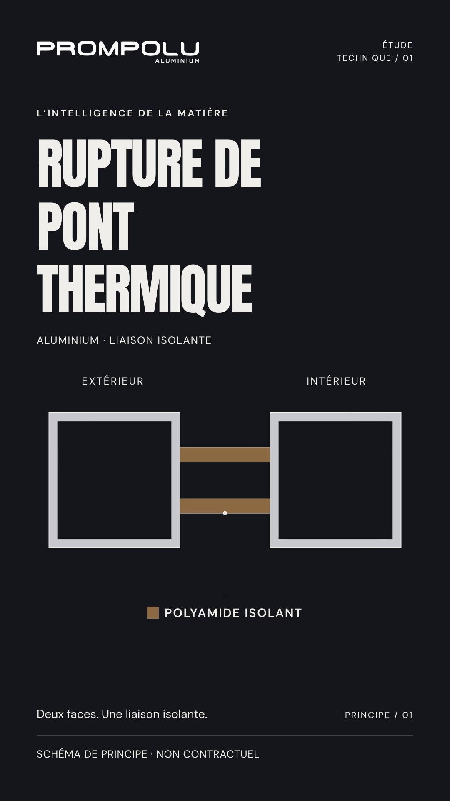

# HyperFrames project skills

All 21 official HyperFrames skills are vendored as real files under `.agents/skills/`, the repository skill discovery directory used by Codex. Each directory contains the complete upstream `SKILL.md`, references, scripts, and assets. Start future motion graphics work by reading `.agents/skills/hyperframes/SKILL.md`. The first editable PROMPOLU technical animation is available below.

## Latest video — SARAPROC MAROC — Présentation (16:9, French voiceover, 3:48)

A premium presentation film for an international cleaning and hygiene meeting. It is Apple-keynote style in navy, blue, white and silver, and all its content and photos come from saraprocmaroc.com.

**Content, in order:**
- SARAPROC's story;
- the medical sector, with the supplied medical logo;
- the industrial sector, with the LAB logo;
- buildings and institutions, water treatment, industrial and livestock buildings, and professional kitchens;
- cosmetic raw materials and cosmetic bases;
- a second, light-themed water section;
- livestock feed supplements and plant nutrition;
- certifications, shown as text labels;
- the official SARAPROC MAROC logo.

**Sound:**
- a French voiceover;
- an original energetic 120 BPM soundtrack;
- a 0.71 s silence with the LAB card between sections, with the music resuming on the downbeat.

- [Master MP4](videos/saraproc-presentation/out.mp4) · [lighter MP4](videos/saraproc-presentation/out-web.mp4) · [poster](videos/saraproc-presentation/poster.jpg)
- [Storyboard](videos/saraproc-presentation/STORYBOARD.md) · [contact sheet](videos/saraproc-presentation/evidence/contact-sheet.jpg) · [sources, choices and rebuild](videos/saraproc-presentation/README.md)

## PROMPOLU — « La qualité, notre meilleur profil. » (9:16 for prompolu.com)

A vertical website video (1080 × 1920, 60 fps, 15 s) in the motion-reel style, built from the site's own content:
- the slogan, with the O of PROFIL becoming the bronze window frame;
- the four ranges in the site's photos, each changing like its product (sliding pane, swinging sash, drawer, pergola louvres);
- "+18 ans" and Distributeur officiel STRUGAL;
- Fès & Sefrou, then the logo and prompolu.com.

- [Master MP4 with sound](videos/prompolu-site-9x16/out.mp4) · [lighter web MP4](videos/prompolu-site-9x16/out-web.mp4) · [poster](videos/prompolu-site-9x16/poster.jpg)
- [Contact sheet](videos/prompolu-site-9x16/evidence/contact-sheet.jpg) · [embed snippet, storyboard and choices](videos/prompolu-site-9x16/README.md)

## PROMPOLU — Motion reel (10 s, 16:9, 60 fps)

A tactile motion-design reel in puffy 3D type and polished bronze. It moves from the dark studio world to the brand's cream paper world: "MOTION", squash and stretch, an easing editor, a toggle morph, a bento of techniques and a "600 frames." odometer, then the supplied PROMPOLU logo. It is one deterministic HTML page with a paused GSAP timeline. Each frame averages 4 sub-frames for motion blur, rendered with Playwright and FFmpeg. The soundtrack is procedural, at 93 BPM, with pops, whooshes and ticks driven by the on-screen motion.

- [1920 × 1080, 60 fps MP4 with sound](videos/prompolu-motion-reel/out.mp4)
- [Contact sheet](videos/prompolu-motion-reel/evidence/contact-sheet.jpg) · [brief stills](videos/prompolu-motion-reel/evidence/brief-stills.jpg) · [sound cues](videos/prompolu-motion-reel/cues.txt)
- [Source, checks, choices and deviations](videos/prompolu-motion-reel/README.md)

## PROMPOLU — Nos gammes (10 s, 16:9)

A cut-free morph-chain website promo: the P mark becomes an app tile, a button, the prompolu.com address bar, a product grid, range cards (Coulissants · Battants · Extérieur) and finally the PROMPOLU ALUMINIUM logo. 1920 × 1080, 30 FPS, exactly 300 frames. It is built as one GSAP-driven HTML page and rendered frame by frame with Playwright and FFmpeg. The soundtrack is original and synthesised: a 125 BPM pop-house bed, with pops and swooshes that follow the motion of each transition.

- [1920 × 1080 MP4 with sound](videos/prompolu-nos-gammes/renders/prompolu-nos-gammes-1920x1080.mp4)
- [Contact sheet](videos/prompolu-nos-gammes/evidence/contact-sheet.jpg) · [sound cues](videos/prompolu-nos-gammes/cues.txt) · [audio analysis](videos/prompolu-nos-gammes/evidence/soundtrack-analysis.png)
- [Source, choices and rendering instructions](videos/prompolu-nos-gammes/README.md)

## Skill — motion-promo-film

The workflow behind *Nos gammes* is saved as a Claude Code project skill in [`.claude/skills/motion-promo-film/`](.claude/skills/motion-promo-film/SKILL.md). In this repository it loads by itself when you ask for a promo film, a logo reveal or sound design for an animation. It contains:

- **A project template.**
  - A deterministic GSAP page with motion blur, typography and logo helpers.
  - A frame-accurate Playwright and FFmpeg renderer.
  - A motion export for the soundtrack.
- **A sound engine.** It synthesises pops, swooshes, hits and a music bed that follow the motion on screen, and masters them to −15 LUFS.
- **Review and verification tools:** contact sheets, audio analysis, last-frame comparison and final-file checks.
- **References:** the engine, sound design, a review checklist and the PROMPOLU worked example.
- **Three test cases** in `evals/`.

Start a new film with `bash .claude/skills/motion-promo-film/scripts/new_film.sh videos/<name> <name>`.

## 60-second photographic version

Rebuilt with real photographic imagery, the website's light ivory/dark ink/bronze identity, French voiceover and original music. 1080 × 1920, 30 FPS, 60 seconds. Photos are credited illustrative stock, not claims of PROMPOLU installations.

- [Full-resolution 60-second MP4](videos/prompolu-thermal-break-60s/renders/PROMPOLU-60s-1080x1920.mp4)
- [Smaller 60-second preview](videos/prompolu-thermal-break-60s/renders/PROMPOLU-60s-preview-540x960.mp4)
- [Editable project ZIP](artifacts/PROMPOLU-60s-editable.zip)
- [Source, credits and rendering instructions](videos/prompolu-thermal-break-60s/README.md)

Open an MP4 on GitHub and select **Download raw file** to play it locally.

## New design reference — Tubik architecture motion

[Observed style and motion breakdown](references/tubik-architecture-27477873/README.md), including attributed frame studies, reusable design tokens, a timestamped motion map, and a proposed French 60-second PROMPOLU storyboard. This extracts the actual Dribbble MP4; it does not replace or rerender the existing film.

## Source and installation

- Official instructions: https://github.com/heygen-com/hyperframes#skills
- Source: `heygen-com/hyperframes`
- Pinned revision: `b306438e8b5e2199db1ed07e6eb4332d53131048`
- Upstream license: `HYPERFRAMES-LICENSE`
- Published bundle manifest: `hyperframes-skills-manifest.json`

Read the upstream README before updating. The documented full installer is:

```sh
npx hyperframes skills
```

In this cloud instance that command could not fetch the published manifest, fell back to 10 core skills, then failed to write its global directories under `/home/agent`. It exited zero despite reporting missing skills. A native HTTPS Git clone succeeded, so installation was completed with the official skills installer in project copy mode:

```sh
git clone --depth 1 https://github.com/heygen-com/hyperframes.git /tmp/hyperframes-official
# Run from this repository:
npx --yes skills add /tmp/hyperframes-official --skill '*' --agent codex --copy --yes
```

For updates, use a fresh clone and review the upstream revision. The installer produces a `skills-lock.json` referring to the temporary local source; that nonportable generated lock was omitted in favor of the committed upstream manifest and revision above.

## Validation

Installation reported 21 skills. All 945 installed files were compared byte for byte with the pinned source; all matched, and no symlinks were present. The published 21 skill names each have a nonempty `SKILL.md` with name and description frontmatter.

Codex runtime discovery is verified with the official Codex CLI 0.110.0: its app-server `skills/list` method, called with this repository as `cwd` and `forceReload: true`, returned all 21 repository skills and zero errors. This check required no model invocation or video creation. All 21 bundles also match the published upstream whole-directory hashes, and every installed file is tracked in Git.

The preinstalled Codex CLI 0.163.0 cannot initialize its app server because the cloud-mounted Codex home is read-only (`installation_id` writes fail). Discovery through that specific runtime remains blocked; the compatibility check above used an isolated official 0.110.0 CLI with SQLite state directed to `/tmp`. The installed skill files were unchanged.

The rendering project has its own pinned CLI commands and validation evidence under `videos/prompolu-thermal-break/`.


## PROMPOLU — first motion graphics test

Five-second French technical animation, rendered using HyperFrames at 30 FPS. The schematic is generic and labeled non-contractual.

- [1080 × 1920 MP4](videos/prompolu-thermal-break/renders/prompolu-thermal-break-1080x1920.mp4)
- [540 × 960 preview MP4](videos/prompolu-thermal-break/renders/prompolu-thermal-break-test-540x960.mp4)
- [Download the editable project ZIP](artifacts/prompolu-thermal-break-editable.zip)
- [Editable source and rendering instructions](videos/prompolu-thermal-break/README.md)

For a file download, open the file above and select **Download raw file** on GitHub.


