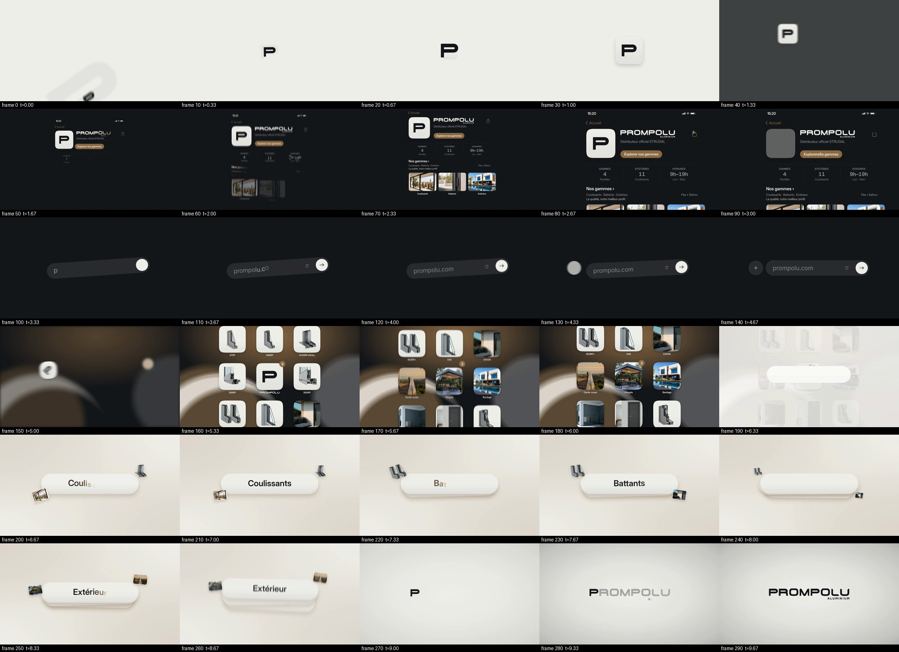

# PROMPOLU — Nos gammes (10 s morph-chain website promo)

A 10-second, 1920 × 1080, 30 fps motion-graphics film with no cuts. One rounded form keeps transforming: P mark → app tile → button → address bar → tile → badge → word card → logo. Along the way the background moves from paper to ink, then to a blurred ink-and-bronze wallpaper, then to warm paper and finally a soft warm-gray vignette. Content: a visit to prompolu.com that scrolls through the three ranges, **Coulissants**, **Battants** and **Extérieur**. All on-screen text is in French.

- [Final MP4, 1920 × 1080, 10.00 s, 300 frames](renders/prompolu-nos-gammes-1920x1080.mp4)
- [Contact sheet, every 10th frame](evidence/contact-sheet.jpg) · [last frame](evidence/final-frame-299.png) · [verification](evidence/verification.json)
- [Sound-design cue sheet](cues.txt). The film is silent because no audio files were supplied.



## How it is built

`index.html` is the whole film: one self-contained page with a 1920 × 1080 `#stage`, driven by one paused GSAP 3 master timeline.

- `window.seek(t)` sets the timeline to *t* seconds deterministically. There is no clock and no `Math.random` at render time. Seeking the same *t* in any order produces byte-identical frames.
- `window.__ready` resolves once the fonts are loaded and every image is decoded. If an image fails, it is replaced by a PAPER tile with the product name in INK, Inter Display 600.
- Every scene sits inside the `#camera` wrapper, whose transform animates the push-ins, drifts, tilt and pan.
- Velocity motion blur: each moving element gets its own SVG `feGaussianBlur`. At every seek the timeline is also sampled half a frame either side. The displacement over one frame (about a 180° shutter) sets `stdDeviation` along the motion axis (`"14 0"` horizontal, `"0 14"` vertical), with a cap per element: 16 for the grid fling, 18 for the whip-down. The blur is removed when the element is still.
- Logos: the three SVGs from `assets/` are inlined verbatim, and every letter path is animated directly (fill, transform, blur). The inverse copy's ids are prefixed `inv-` so they don't clash with the ink logo's `#L1…#S9`. Paths, kerning and fill-rule are untouched. The bronze sheen is a gradient band inside an SVG `<clipPath>` built with `<use>` from the same logo paths.
- Text: Inter Display 400/500/600 (with Inter 400 for the typed URL), bundled in `assets/fonts/` under the OFL. Words are split into letters at their kerned positions for the bronze-ink settle.
- Colours: only the brand tokens declared in `:root`. Shadows are rgba of INK or BRONZE. Product photos and cutouts keep their natural colours.

`scripts/render.mjs` loads the page in headless Chromium (Playwright), seeks to `t = frame / 30` for frames 0–299, screenshots each frame as PNG and pipes it to FFmpeg: `libx264`, `yuv420p`, CRF 16, `+faststart`, BT.709 matrix and tags.

## Commands

```sh
npm ci            # Playwright 1.56.1 (uses the preinstalled Chromium; set PLAYWRIGHT_SKIP_BROWSER_DOWNLOAD=1 if it is already present)
npm run render    # → renders/prompolu-nos-gammes-1920x1080.mp4 (about 1.5 min here)
npm run stills    # review PNGs → renders/stills/
npm run preview   # http://127.0.0.1:4173/ plays the film in a loop; add ?t=6.95 to freeze a moment
```

Other options: `node scripts/render.mjs --frames 150-210` renders only part of the film, and `--out path.mp4` changes the output file. FFmpeg must be on the `PATH`.

## Assets

| File | Source |
| --- | --- |
| `assets/prompolu-logo.svg`, `prompolu-logo-inverse.svg`, `prompolu-icone-P.svg` | Supplied brand files, unchanged |
| `assets/window-original.jpeg`, `battants.png`, `products/…` | Downloaded with curl from `https://prompolu.com/assets/` (the 16 files listed in the brief) |
| `assets/fonts/Inter*.otf` | Inter / Inter Display 4.0, SIL OFL 1.1 (`OFL-Inter.txt`) |
| `assets/vendor/gsap.min.js`, `MotionPathPlugin.min.js` | GSAP 3.12.5 (cdnjs) |

## Choices worth knowing

- **Final frame vs. the 9.70–10.00 push-in.** The brief asks for both a 1.000 → 1.015 push-in during the hold and a last frame showing the logo at exactly 860 px. To satisfy both, the push-in is applied to the studio vignette behind the logo. The logo itself ends identical to `prompolu-logo.svg`, 860 px wide and centred at (960, 540). A pixel comparison with the SVG rendered on its own gives the same ink bounding box, with differences only in sub-pixel anti-aliasing (`evidence/verification.json`). The last rendered frame is frame 299, at t = 9.967 s.
- **Icon pop spring.** The tile reaches exactly 310 px and settles at 290 px. A damped spring tuned to that overshoot replaces stock `elastic.out(1, 0.45)`, which would peak at about 326 px. The card drops use the same kind of soft spring. `elastic.out(1, 0.5)` is used where the brief names it (the P drop).
- **Squircles** use CSS `corner-shape` (Chromium 139+): `border-radius: 34%` with a squircle shape. This matches a 22.5 % iOS-style continuous corner, and morphs from the circle by tweening `superellipse(1 → 2)`.
- **Letter staggers** follow the brief's time windows. For long lines (the page subtitles) and for "Coulissants" (6.48–6.78) the stagger is shortened so every letter lands inside its window.
- **Pointer and tick** are BRONZE with a thin PAPER outline. Without it they would vanish against the BRONZE button they tap.
- **No third-party marks.** The A200 4FH2 photo carries a small "ALUDOORS" mark in its top corner, which the tile crop (`object-position: 40% 100%`) keeps out of frame. "Distributeur officiel STRUGAL" appears as plain text, as briefed, not as a logo.
- **Sound.** No audio files were supplied, so the MP4 has no audio stream. `cues.txt` lists every cue with its time.
